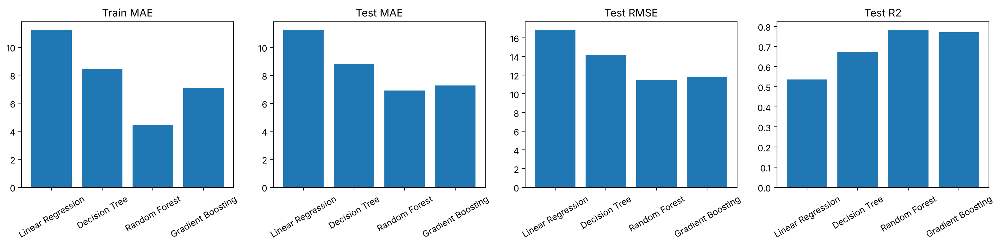
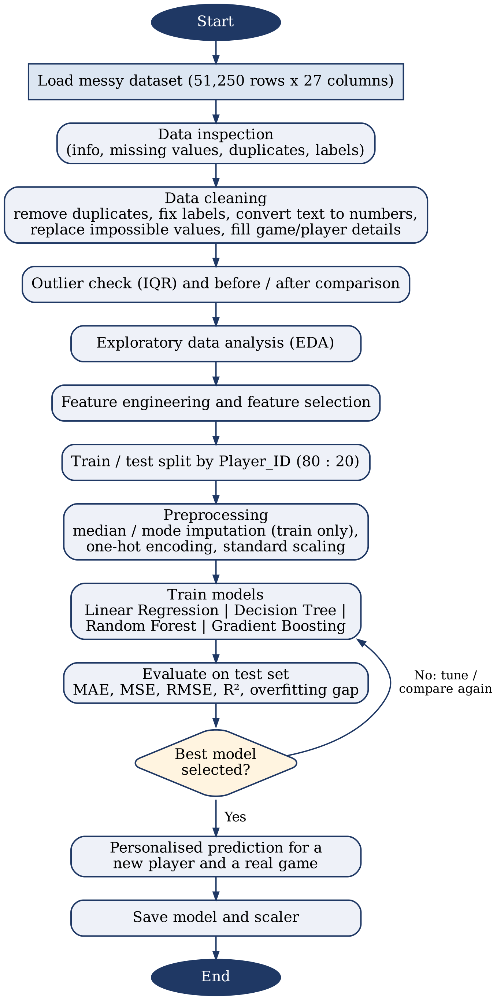

# Personalized Video Game Completion Time Prediction

Predicting how many hours a **specific player** will take to finish the **main story** of a **specific game**, from the player's profile, the game's properties and the player's behaviour in the **first two hours** of play.

**Course:** CSET211 – Statistical Machine Learning, Bennett University (July–Dec 2026)
**Faculty:** Basab Nath

| Enrollment No. | Name |
|---|---|
| S25CSEU2130 | Faraz Ahmad |
| S25CSEU2131 | Yash Chaudhary |
| S25CSEU2151 | Guddu Kumar |

> **The player data is synthetic.** The 100 games and their real attributes (genre, typical main-story hours, mission count, difficulty) come from HowLongToBeat, Steam tags and game guides. The players, their gameplay behaviour and completion times are simulated. Every `Player_ID` starts with `SYN_`.

---

## Results

On a test set of 1,998 unseen players (9,833 records):

| Model | Test MAE (h) | Test RMSE (h) | Test R² | Train–test R² gap |
|---|---|---|---|---|
| Linear Regression | 11.27 | 16.87 | 0.536 | −0.002 |
| Decision Tree | 8.78 | 14.18 | 0.672 | 0.043 |
| **Random Forest** | **6.92** | **11.51** | **0.784** | 0.120 |
| Gradient Boosting | 7.27 | 11.84 | 0.772 | 0.021 |

- **Best model:** Random Forest. Gradient Boosting comes very close and overfits less.
- **Strongest predictor:** story progress after two hours, about 62% of the Random Forest's feature importance.
- **Accuracy:** 30.3% of predictions are within 2 hours of the true time, and 58.0% within 5 hours.
- **Personalised predictions:**

| Game | Player | Predicted | Median player |
|---|---|---|---|
| The Witcher 3 | Beginner, Completionist | 86.3 h | 52.0 h |
| The Witcher 3 | Expert, Speedrunner | 26.6 h | 52.0 h |
| Portal 2 | Expert, Speedrunner | 5.9 h | 8.9 h |



---

## Repository structure

```
game-completion-time-prediction/
├── README.md
├── requirements.txt
├── .gitignore
├── notebooks/
│   └── Personalized_Game_Completion_Prediction.ipynb   # main notebook (already run, outputs saved)
├── data/
│   ├── gaming_player_completion_dataset.csv            # messy dataset used by the notebook (51,250 rows x 27 cols)
│   ├── gaming_player_completion_dataset_clean.csv      # defect-free version, used only to check the cleaning
│   ├── game_catalogue.csv                              # 100 real games, attributes and mission-count sources
│   └── DATA_CARD.md                                    # what is real, what is simulated, and the data-quality problems
├── src/
│   └── generate_gaming_dataset.py                      # script that generates the three data files (seed 42)
├── report/
│   └── SML_Project_Report_Game_Completion_Time.docx    # project report
├── presentation/
│   └── Game_Completion_Time_Prediction.pptx            # presentation slides
└── images/
    ├── methodology_flowchart.png
    ├── model_comparison.png
    ├── actual_vs_predicted.png
    └── feature_importance_rf.png
```

---

## How to run

### Option 1: Google Colab (recommended)
1. Open `notebooks/Personalized_Game_Completion_Prediction.ipynb` in [Google Colab](https://colab.research.google.com/). Choose **File → Upload notebook**, or open it from GitHub.
2. In the Colab **Files** panel, upload `data/gaming_player_completion_dataset.csv`.
3. Click **Runtime → Run all**. The free CPU runtime is enough, and no GPU is needed.

### Option 2: Run locally
```bash
git clone <this-repository-url>
cd game-completion-time-prediction
pip install -r requirements.txt
jupyter notebook notebooks/Personalized_Game_Completion_Prediction.ipynb
```
The notebook first looks for the CSV in its own folder, then in `../data/`.

### Regenerating the dataset (optional)
```bash
python src/generate_gaming_dataset.py data
```
The script uses fixed random seeds, so it produces exactly the same three files each time.

---

## Methodology



1. **Load and inspect** the messy file (missing values, duplicates, inconsistent labels).
2. **Clean the data:**
   - remove duplicates;
   - fix labels and names;
   - convert numbers stored as text;
   - replace impossible values;
   - fill game and player details from other rows of the same game or player.
3. **Check outliers** with IQR and compare the data before and after cleaning.
4. **EDA:** look at distributions, group comparisons, time relative to each game's median, and a correlation heatmap.
5. **Feature engineering:** add `Mission_Progression_Rate`, `Retry_Intensity` and `Optional_Content_Per_Hour`, and drop the ID columns.
6. **Train–test split by player** (80:20), so no player appears in both sets.
7. **Preprocessing,** fitted on the training data only:
   - median and mode imputation;
   - one-hot encoding;
   - `StandardScaler`.
8. **Train** Linear Regression, Decision Tree, Random Forest and Gradient Boosting.
9. **Evaluate** with MAE, MSE, RMSE and R², and check for overfitting.
10. **Personalised prediction** with `predict_completion_time(game_name, player)`.

---

## Dataset summary

| | |
|---|---|
| Records | 50,000 unique player–game records (51,250 rows in the messy file) |
| Players | 10,000 (synthetic) |
| Games | 100 real titles: 25 RPG, 22 Action, 18 Adventure, 16 Open World, 11 Strategy, 8 Survival |
| Target | `Completion_Time_Hours` |
| Problems added on purpose | missing values, duplicates, typos, numbers stored as text, impossible values, unit errors |

See [`data/DATA_CARD.md`](data/DATA_CARD.md) for full details. The per-game mission-count sources are in [`data/game_catalogue.csv`](data/game_catalogue.csv).

---

## Notes

- **Trained model not included:** `best_model.joblib` is about 116 MB, over GitHub's 100 MB file limit. Running the notebook creates it again, along with `scaler.joblib`.
- **Results are from simulated players:** they show that the method works, not how accurate it would be on real players.

## References

1. Pedregosa, F., et al. (2011). Scikit-learn: Machine learning in Python. *JMLR*, 12, 2825–2830.
2. Breiman, L. (2001). Random forests. *Machine Learning*, 45(1), 5–32.
3. Friedman, J. H. (2001). Greedy function approximation: A gradient boosting machine. *The Annals of Statistics*, 29(5), 1189–1232.
4. HowLongToBeat – https://howlongtobeat.com/
5. Steam store and user tags – https://store.steampowered.com/

The full reference list is in the project report.
